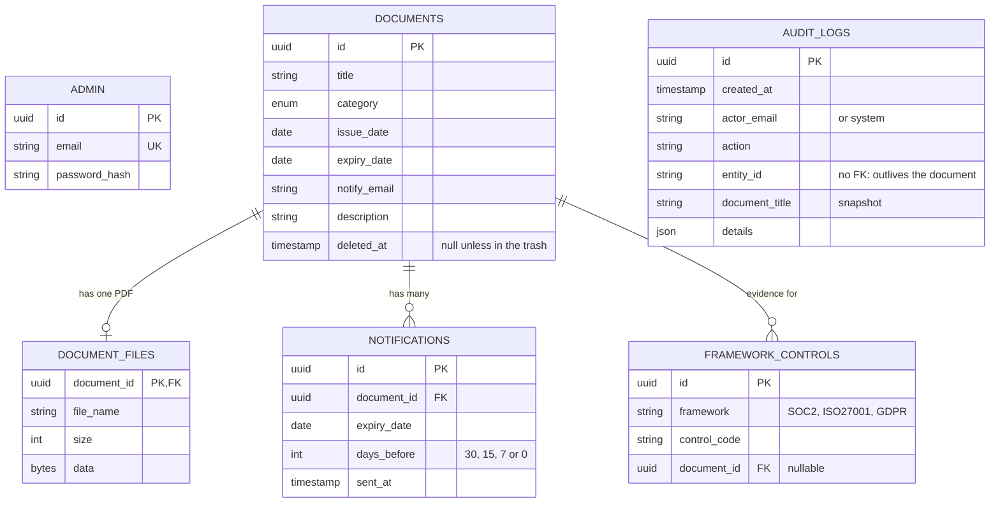

# DocShield: Regulatory Compliance Document Tracker

DocShield is a core dashboard application designed to record, track, and monitor organization-level compliance documents (such as corporate licenses, certificates, insurance policies, permits, and tax clearances). 

The platform implements real-time warning indicators, computed expiration statuses, interactive analytics dashboards, and deduplicated email notification warnings.

---

## Technical Stack
* **Backend API Engine**: Node.js, Express, Prisma ORM, Multer (in-memory upload, PDFs stored in Postgres), Nodemailer, Zod.
* **Frontend Web App**: React (Vite), React Router, Vanilla CSS, responsive layouts.
* **Database Layer**: PostgreSQL.
* **Hosting**: Render (API), Vercel (frontend), Neon or Supabase (Postgres). No Docker.
* **Quality**: Node's built-in test runner + supertest, OpenAPI route-coverage test, GitHub Actions CI.

---

## Project Structure
```text
compliance-document-tracker/
├── backend/
│   ├── prisma/             # Schema definitions and seeding scripts
│   ├── src/
│   │   ├── controllers/    # API logical controllers
│   │   ├── docs/           # OpenAPI JSON specifications
│   │   ├── middleware/     # Auth and file uploads filters
│   │   ├── routes/         # Endpoint router registrations
│   │   ├── services/       # node-cron scheduler alert engine
│   │   └── app.js          # Express app entry node
│   ├── uploads/            # Local PDF file storage path
├── frontend/
│   ├── src/
│   │   ├── components/     # Reusable layout UI blocks
│   │   ├── context/        # Login auth session hooks
│   │   ├── pages/          # React route views (Dashboard, Documents)
│   │   ├── App.jsx         # Component layout router
│   │   └── index.css       # Core vanilla CSS design palette
│   └── vite.config.js      # Proxy API redirects configuration
├── docs/                   # ARCHITECTURE, HANDOFF (operations), MASTER_PLAN (audit), build log
├── .github/workflows/      # CI: migrations, tests, frontend build, dependency audit
├── render.yaml             # Render web service definition (backend)
└── README.md               # User quickstart reference guide
```

---

## Port Mappings
* **Vite Frontend Dev Host:** `http://localhost:3000`
* **Express Backend Master API:** `http://localhost:5000`
* **Swagger API Specification:** `http://localhost:5000/api-docs`

---

## Data Model



`audit_logs` is append-only: a database trigger rejects UPDATE, DELETE and TRUNCATE, and entries are written in the same transaction as the change they describe. `notifications` is unique on (`document_id`, `expiry_date`, `days_before`); `framework_controls` is unique on (`framework`, `control_code`). Status is computed, not stored: expired is before today, expiring soon is 0-30 days, active is more than 30 days (today is taken in `APP_TIMEZONE`).

More detail: [`docs/ARCHITECTURE.md`](docs/ARCHITECTURE.md). Operations runbook: [`docs/HANDOFF.md`](docs/HANDOFF.md). OpenAPI/Swagger: `/api-docs`.

## Setup (npm workspaces)

```bash
npm install                      # installs backend + frontend, generates the Prisma client
cp backend/.env.example backend/.env   # then fill in DATABASE_URL and JWT_SECRET (32+ chars)
npm run prisma:generate
npx prisma migrate deploy --schema backend/prisma/schema.prisma
```

Create the admin account (never ships with a default password in production):
```bash
ADMIN_EMAIL=you@example.com ADMIN_PASSWORD='at-least-12-characters' npm run db:create-admin --workspace=backend
```

Optional demo data (refuses to run when `NODE_ENV=production`): `npm run db:seed`. It creates `admin@compliance.com` / `adminpassword` for local use only, plus 10 documents with real sample PDFs. Set `DEMO_NOTIFY_EMAIL` so their reminders go to an inbox you own, and `SEED_REFRESH_DATES=true` to re-base the seeded dates on today.

Run both dev servers with `npm run dev`; run the tests with `npm test` (integration tests need `DATABASE_URL` pointing at a throwaway database).

## Deployment
* **Backend (Render, Node runtime):** `render.yaml` defines the service. Build `npm ci`, start `npm run start:prod --workspace=backend` (applies migrations, then starts the API). Required env vars: see `backend/.env.example`. Set `NODE_ENV=production`.
* **Database:** Neon or Supabase Postgres. Uploaded PDFs are stored in the `document_files` table, so nothing depends on the host's disk.
* **Daily alerts on a sleeping host:** point an external scheduler (e.g. cron-job.org) at `POST /api/services/cron/run` with header `x-cron-secret: $CRON_SECRET`. The API also runs a catch-up scan shortly after every boot.
* **Frontend (Vercel):** root directory `frontend`; `vercel.json` rewrites `/api/*` to the backend.

## API Endpoints List

### 1. Authentication
* `POST /api/auth/login` - Retrieve a JWT (12h by default). Only failed attempts count toward the rate limit.

### 2. Documents (JWT required)
* `GET /api/documents?search&category&status&page&limit&sort&order` - Paginated list (limit 1-100). Invalid values return 400.
* `POST /api/documents` - Create with a PDF upload (max 5MB, checked by magic bytes).
* `GET /api/documents/:id` - Details (`hasFile`, `file.fileName`, `file.size`).
* `PUT /api/documents/:id` - Update metadata and optionally replace the PDF.
* `DELETE /api/documents/:id` - Move to the trash (soft delete); restorable for `RETENTION_DAYS` (default 30), then purged.
* `GET /api/documents?trash=true` - List the trash.
* `POST /api/documents/:id/restore` - Restore from the trash.
* `DELETE /api/documents/:id/permanent` - Permanently delete a trashed document now.
* `GET /api/documents/:id/file` - Download the PDF.

### 3. Dashboard (JWT required)
* `GET /api/dashboard` - Status counts (`active`, `expiringSoon`, `expired`, `expiring7d/30d/60d/90d`), categories, health rate, monthly uploads.

### 4. Audit trail (JWT required)
* `GET /api/audit-logs?action&entityId&actor&from&to&page&limit` - Append-only history of who did what: sign-ins (including failures), document create/update (with field-level before/after)/download/delete/restore/purge, framework links, expiry scans. `entityId=<document id>` returns one document's full history.

### 5. Background services
* `POST /api/services/cron/trigger` - Admin-triggered expiry scan (JWT). Returns 502 if the mail server or any send fails.
* `POST /api/services/cron/run` - Same scan for an external scheduler (`x-cron-secret` header).

## Expiry Warnings Strategy
A warning is sent once a document is inside the **30, 15, 7 or 0 days** window (0 = expired or expires today). It is state-based, so a late upload or a missed run still gets the warning. Each warning is recorded once per (document, expiry date, threshold) in `notifications`; renewing a document starts a fresh cycle.

In production a missing or unreachable SMTP server fails the scan loudly and releases the claim so the next scan retries. The console mail mock is used only outside production when `SMTP_HOST` is unset.
